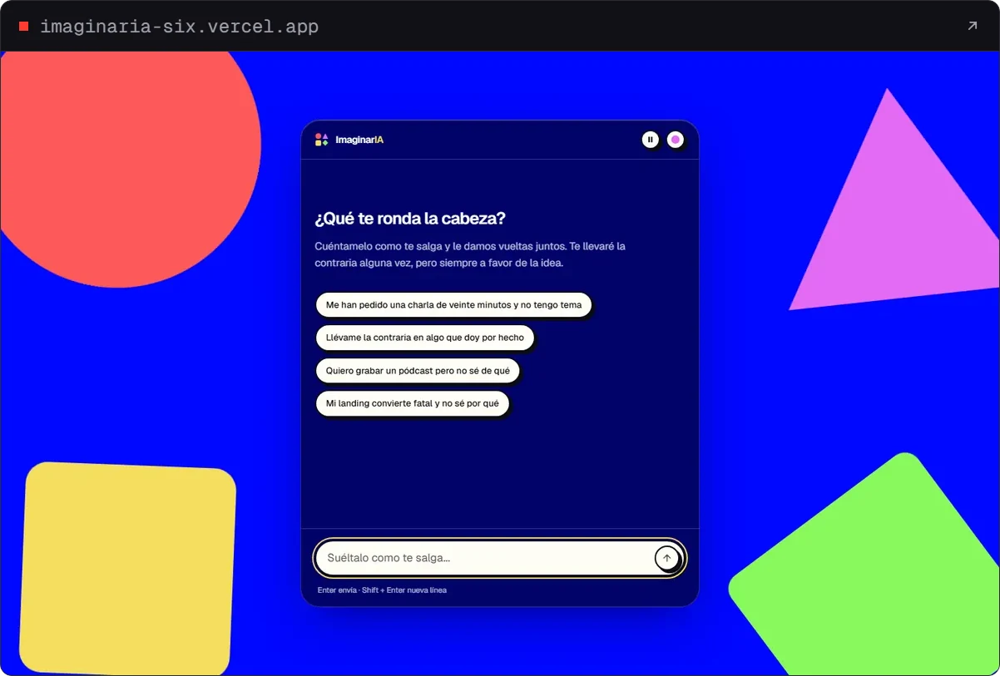
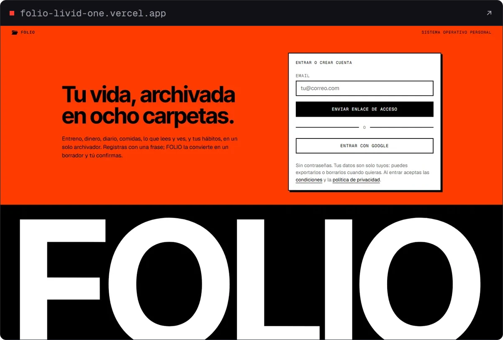
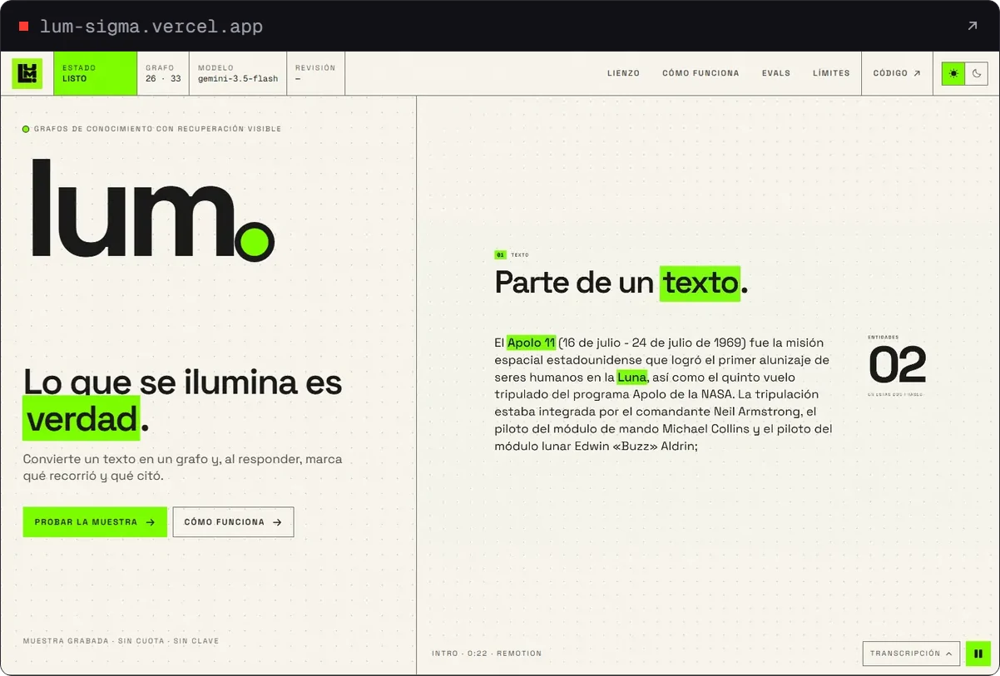
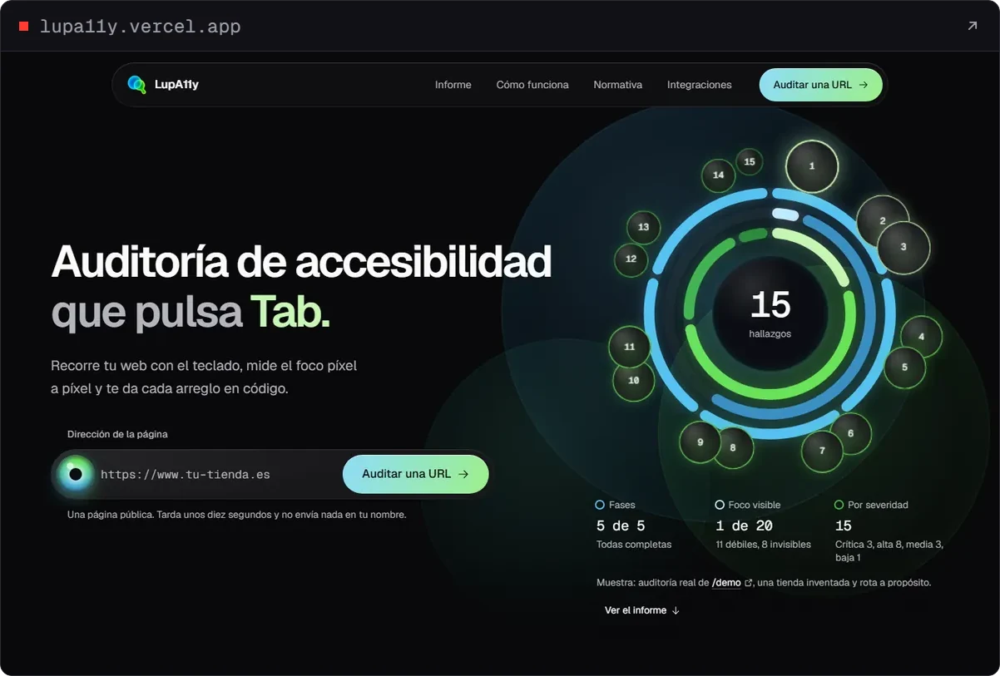
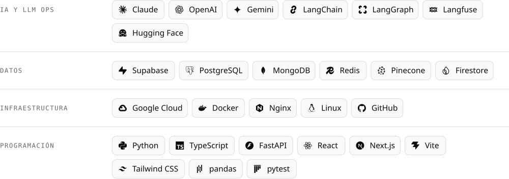

<picture>
  <source media="(prefers-color-scheme: dark)" srcset="assets/banner-dark.svg">
  
</picture>

<br>

<a href="https://www.linkedin.com/in/adri%C3%A1n-mart%C3%ADnez-pan%C3%A9s/"><picture><source media="(prefers-color-scheme: dark)" srcset="assets/btn-linkedin-dark.svg"></picture></a>&nbsp;<a href="https://huggingface.co/Adriiiii24"><picture><source media="(prefers-color-scheme: dark)" srcset="assets/btn-huggingface-dark.svg"></picture></a>

Me apasiona transformar las ideas en realidad. Disfruto agilizando procesos, dándoles un toque personal y haciéndolos más eficaces, y me interesan mucho las ideas y los conocimientos de los demás.

Construyo sistemas de IA de punta a punta y me gusta que se puedan medir: trazas en Langfuse, evals en Python y suites de `claude plugin eval`.

## Proyectos

<table>
<tr>
<td width="50%" valign="top">

<a href="https://imaginaria-six.vercel.app/"></a>

**[ImaginarIA](https://imaginaria-six.vercel.app/)**<br>
Un chat que construye ideas contigo y te discute la premisa.

<sub>Next.js 16 · Gemini y Groq · Langfuse</sub><br>
<sub>[Demo](https://imaginaria-six.vercel.app/) · [Código](https://github.com/Adriiiii24/ImaginarIA)</sub>

</td>
<td width="50%" valign="top">

<a href="https://folio-livid-one.vercel.app/"></a>

**[FOLIO](https://folio-livid-one.vercel.app/)**<br>
Un sistema operativo personal con forma de archivador.

<sub>Next.js 16 · Supabase con RLS · Gemini</sub><br>
<sub>[Demo](https://folio-livid-one.vercel.app/) · [Código](https://github.com/Adriiiii24/FOLIO)</sub>

</td>
</tr>
<tr>
<td width="50%" valign="top">

<a href="https://lum-sigma.vercel.app/"></a>

**[LUM](https://lum-sigma.vercel.app/)**<br>
Convierte un texto en un grafo y enseña qué recorrió y qué citó.

<sub>Grafo de conocimiento · Gemini · evals en Python</sub><br>
<sub>[Demo](https://lum-sigma.vercel.app/) · [Código](https://github.com/Adriiiii24/LUM)</sub>

</td>
<td width="50%" valign="top">

<a href="https://lupa11y.vercel.app/"></a>

**[LupA11y](https://lupa11y.vercel.app/)**<br>
Auditoría de accesibilidad que pulsa Tab.

<sub>Playwright · axe-core · Gemini Vision · servidor MCP</sub><br>
<sub>[Demo](https://lupa11y.vercel.app/) · [Código](https://github.com/Adriiiii24/LUPA11Y)</sub>

</td>
</tr>
</table>

## web-guardrails

Plugin de Claude Code con tres skills para construir webs con criterio: **seguras**, **legales en España y la UE** y **sin gastar de más en modelos**. Cada regla cita su norma o estándar.

```text
/plugin marketplace add Adriiiii24/web-guardrails
/plugin install web-guardrails@adriiiii24
```

| Caso de la suite | Sin&nbsp;plugin | Con&nbsp;plugin |
|:--|--:|--:|
| `sec-login`<br><sub>Error genérico, límite de intentos, cookies HttpOnly y comprobación de origen</sub> | 0,88 | **1,00** |
| `sec-password`<br><sub>15 caracteres, sin reglas de composición, contraseñas filtradas y NFC</sub> | 0,89 | **1,00** |
| `ai-chatbot`<br><sub>Clave en el servidor, límites de uso y aviso de que es una IA</sub> | 0,75 | **1,00** |
| `legal-checkout`<br><sub>«Pedido con obligación de pago», IVA, 14 días y botón de desistimiento</sub> | 0,75 | **1,00** |
| `legal-newsletter`<br><sub>Casillas sin marcar, doble opt-in, versión de los textos aceptados y baja</sub> | 0,83 | **1,00** |
| `legal-cookies`<br><sub>Rechazar al mismo nivel, analítica bloqueada, caducidad y transferencia a EE.&nbsp;UU.</sub> | 1,00 | **1,00** |

<sub>`claude plugin eval`, 18/10/2026, claude-opus-5-5: una ejecución con el plugin y otra sin él por caso. El `model-router` se mide aparte, porque sin el plugin el comando no existe. [Ver el repositorio →](https://github.com/Adriiiii24/web-guardrails)</sub>

## Stack

<picture>
  <source media="(prefers-color-scheme: dark)" srcset="assets/stack-dark.svg">
  
</picture>

## Trayectoria

<table>
<tr>
<td valign="top"><b>AyGLOO</b><br><sub>2/2026&nbsp;—&nbsp;hoy</sub></td>
<td>Ingeniero de IA y LLM Ops. Arquitecturas agénticas, módulos de procedimiento y automatización avanzada.</td>
</tr>
<tr>
<td valign="top"><b>Navantia&nbsp;Sistemas</b><br><sub>9/2024&nbsp;—&nbsp;12/2024</sub></td>
<td>Administración de sistemas y gestión de la seguridad de servidores y usuarios.</td>
</tr>
<tr>
<td valign="top"><b>IES&nbsp;Rafael&nbsp;Alberti</b><br><sub>Cádiz</sub></td>
<td>Especialización en Inteligencia Artificial y Big Data.</td>
</tr>
<tr>
<td valign="top"><b>IES&nbsp;Pablo&nbsp;Ruiz&nbsp;Picasso</b><br><sub>Chiclana de la Frontera</sub></td>
<td>Grados SMR y ASIR.</td>
</tr>
</table>

<br>

<sub>Logos de [Simple Icons](https://simpleicons.org) (CC0), [Lobe Icons](https://github.com/lobehub/lobe-icons) y [Bootstrap Icons](https://icons.getbootstrap.com) (MIT). Tipografías Ronzino y Geist Mono, con licencia SIL OFL 1.1.</sub>
